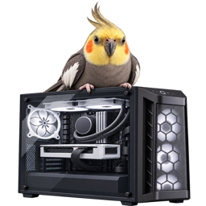
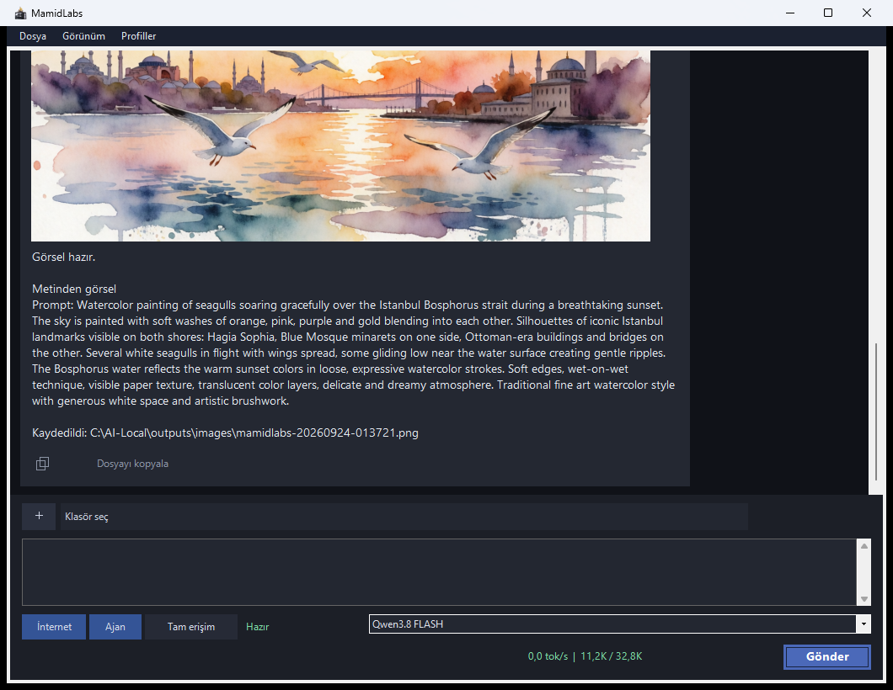
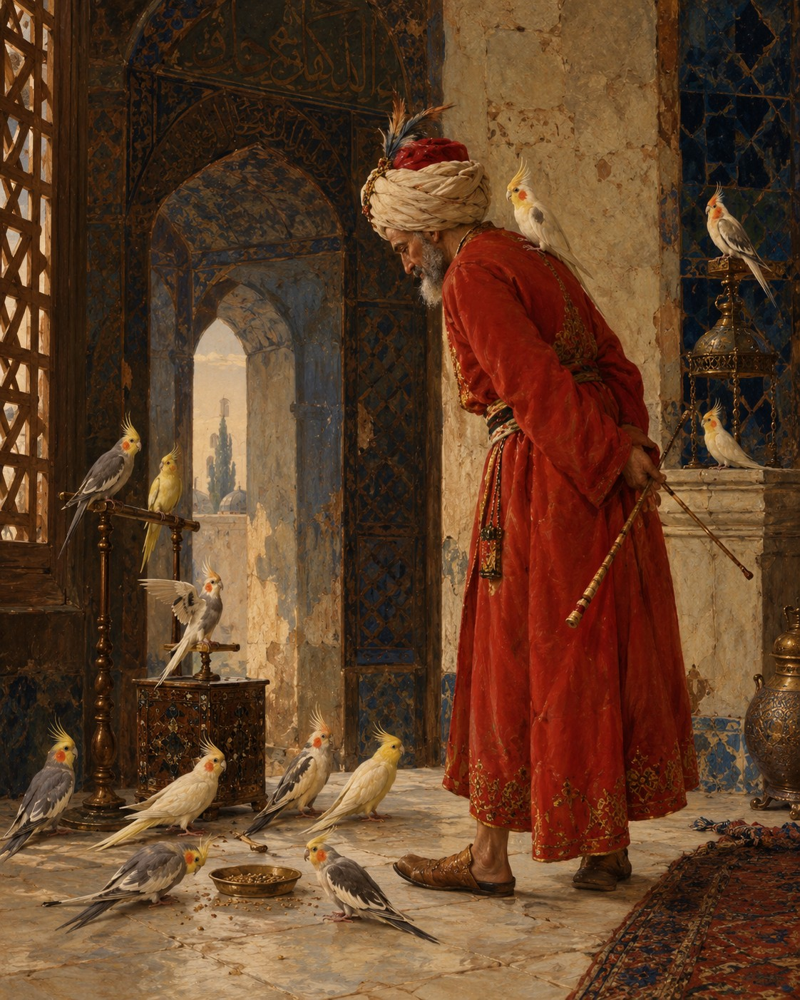
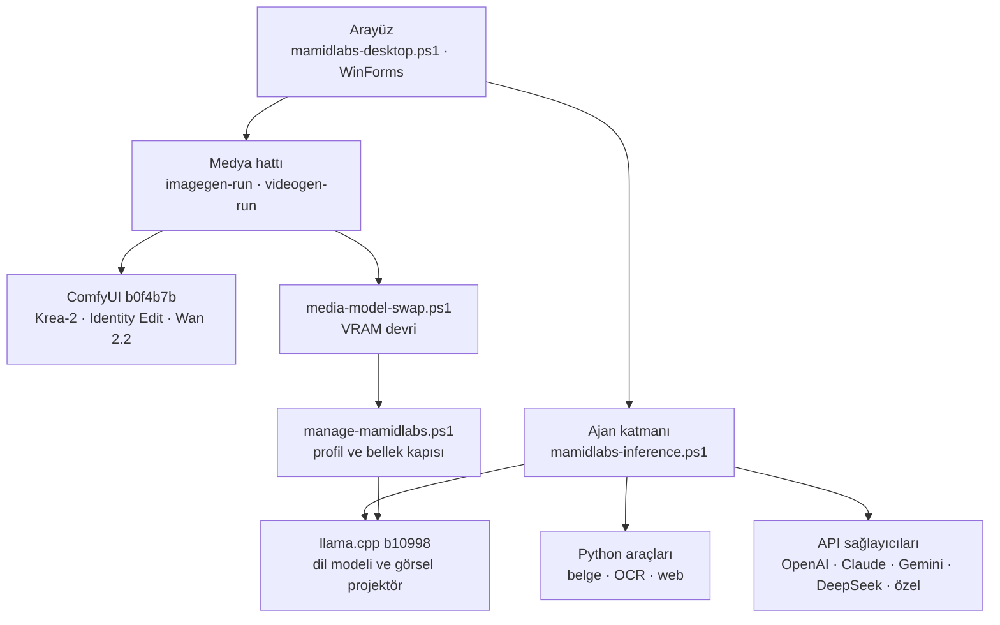
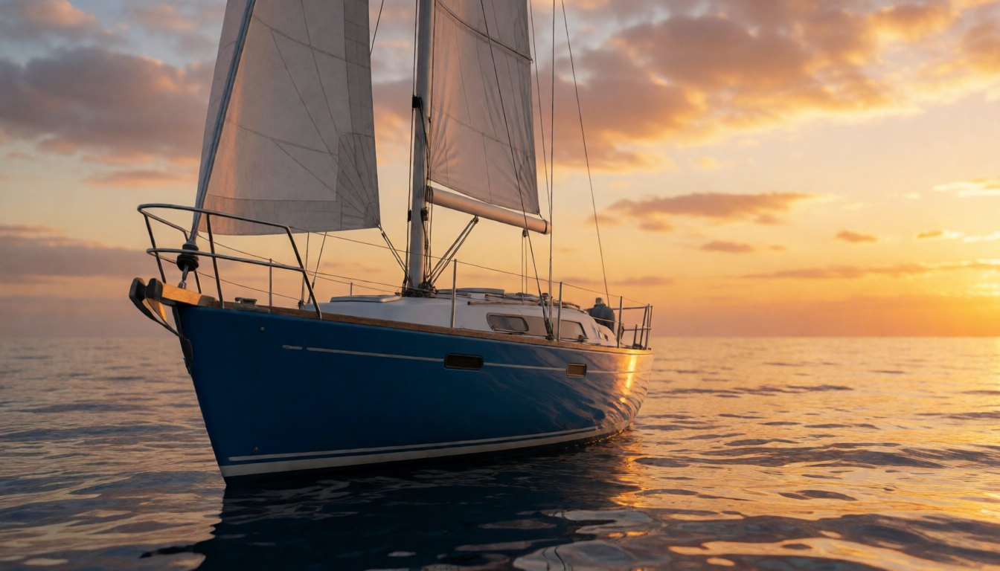
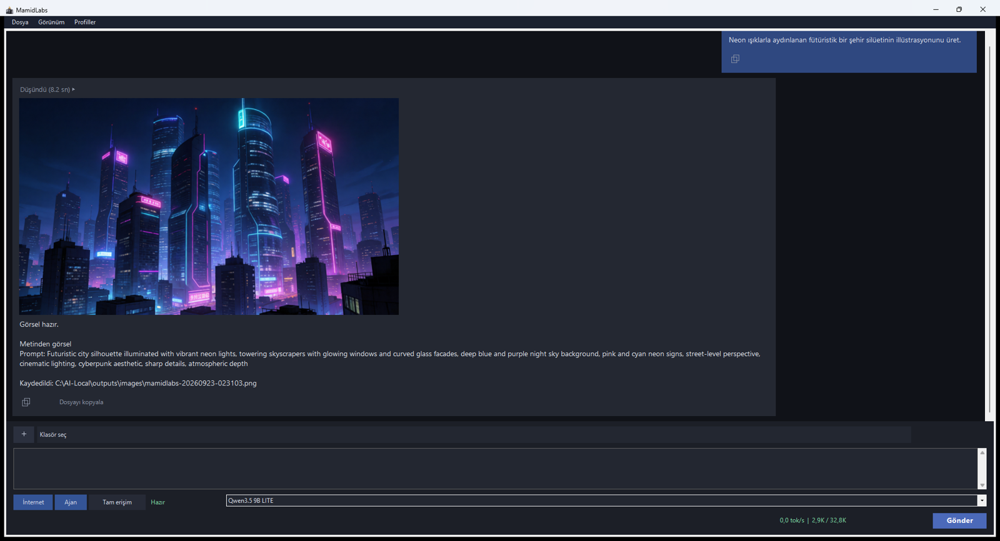

<p align="center">
  
</p>

<h1 align="center">MamidLabs</h1>

<p align="center">
  <a href="https://github.com/workaybarsh/MamidLabsENG"><b>For English</b></a>
</p>

<p align="center">
  <b>Tamamen yerel çalışan, çok modlu yapay zekâ çalışma alanı</b><br>
  Sohbet · Web araması · Belge · OCR · Ses dökümü · Görsel anlama · Görsel ve video üretimi · Fotoğraf düzenleme · Grafik çizimi
</p>

<p align="center">
  
</p>

<p align="center">
  <a href="#platform-desteği">Platform desteği</a> ·
  <a href="#özellikler">Özellikler</a> ·
  <a href="#donanım-profilleri">Donanım profilleri</a> ·
  <a href="#sistem-gereksinimleri">Sistem gereksinimleri</a> ·
  <a href="#kurulum">Kurulum</a> ·
  <a href="#mimari">Mimari</a> ·
  <a href="#güvenlik">Güvenlik</a> ·
  <a href="#test-ve-doğrulama">Test ve doğrulama</a> ·
  <a href="#galeri">Galeri</a> ·
  <a href="#belgeler">Belgeler</a> ·
  <a href="#lisans">Lisans</a>
</p>

MamidLabs; sohbet, web araması, belge okuma ve üretimi, OCR, ses dökümü (konuşma + konuşma dışı
ses olayları), görsel anlama, görsel ve video
üretimi işlerini tek bir masaüstü penceresinde toplar. Dil, görsel ve video modelleri kullanıcının
kendi ekran kartında çalışır. İnternet yalnızca kurulum, model indirme, web araması ve isteğe bağlı
API sağlayıcıları için kullanılır.

---

## Platform desteği

MamidLabs **Windows** için üretilmiştir ve kararlı sürüm burasıdır. Aynı ürünün iki
**deneysel** portu da vardır; ikisi de aynı araç kümesini ve sabitleri paylaşır:

| Platform | Kurulum | Durum |
|---|---|---|
| **Windows** (bu depo) | [MamidLabs_Setup.exe](https://github.com/workaybarsh/MamidLabsTR/releases/latest/download/MamidLabs_Setup.exe) | **Kararlı** (PowerShell + WinForms) |
| **[Linux](https://github.com/workaybarsh/mamidlabs_linux)** | [.deb](https://github.com/workaybarsh/mamidlabs_linux/releases/latest/download/mamidlabs.deb) (kurulum sihirbazı) | **Deneysel** (Python 3.12 + PySide6) |
| **[macOS](https://github.com/workaybarsh/mamidlabs_mac)** | [.dmg](https://github.com/workaybarsh/mamidlabs_mac/releases/latest/download/MamidLabs.dmg) (kurulum sihirbazı) | **Deneysel** (Python 3.12 + PySide6) |

<p align="center">
  
</p>

## Özellikler

| Yetenek | Açıklama |
|---|---|
| **Sohbet** | Qwen3.8 27B (MAX/FLASH) ya da Qwen3.5 9B (LITE); 32K bağlam, otomatik bağlam sıkıştırma |
| **Web araması** | Arama ve sayfa okuma; yanıtta kaynak gösterimi |
| **Belge okuma** | PDF, Word, Excel, PowerPoint, ZIP ve RAR |
| **Belge üretimi** | PDF, Word ve PowerPoint; kullanıcı onayıyla |
| **OCR** | PaddleOCR: görseller GPU'da, taranmış PDF'ler CPU'da |
| **Ses dökümü** | faster-whisper large-v3-tr + Silero VAD; mikrofon kaydı veya ses dosyası kronolojik metne çevrilir |
| **Konuşma dışı sesler** | AST (AudioSet) ile ayak sesi, kapı gibi olaylar parantez içinde; isteğe bağlı konuşmacı ayrımı |
| **Görsel anlama** | Dil modeli eklenen görseli doğrudan yorumlar |
| **Görsel üretimi** | Krea-2 Turbo; yeniden üretim, stil referansı ve istek üzerine gerçekçilik LoRA'sı |
| **Fotoğraf düzenleme** | Krea 2 Identity Edit: kişinin yüzü korunarak kıyafet, ışık ve arka plan değişir; iki görselle kişiyi sahneye yerleştirir (16 GB profiller) |
| **Video üretimi** | Wan 2.2 TI2V 5B; metinden, görselden ve videodan devam |
| **Grafik çizimi** | Çubuk, çizgi, pasta, saçılım ve fonksiyon grafikleri (y=f(x)); sohbetten tek istekle |
| **Ajan modu** | Bağlı klasörde dosya okuma/yazma ve komut çalıştırma; kullanıcı onayıyla |
| **API sağlayıcıları** | İsteğe bağlı OpenAI, Claude, Gemini, DeepSeek ve OpenAI uyumlu özel uç; anahtar doğrulama ve model listeleme |
| **Kendi modellerin** | Dil, görsel ve video modelini dosya yoluyla seç; dosyalar kopyalanmadan yerinde kullanılır |

## Donanım profilleri

| | MAX | FLASH | LITE |
|---|---|---|---|
| Hedef donanım | 16 GB VRAM · 32 GB RAM | 16 GB VRAM · 32 GB RAM | 8 GB VRAM · 16 GB RAM |
| Dil modeli | Qwen3.8 27B IQ4_XS | Qwen3.8 27B IQ4_XS | Qwen3.5 9B Q5_K_M |
| Düşünme | Derin | Kısa | Derin, sınırsız (bütçe yok) |
| Görsel modeli | Krea-2 Turbo fp8 | Krea-2 Turbo fp8 | Krea-2 Turbo GGUF Q4_K_M |
| Model indirmesi | ~52 GB (FLASH ile ortak) | ~52 GB | ~36 GB |
| Ölçülen sohbet hızı | ~42–58 tok/s | ~42–58 tok/s | ~97 tok/s (16 GB'ta) |

MAX ve FLASH aynı dosyaları kullanır; kurulumda tek bir **Qwen3.8 27B** seçeneği olarak sunulur,
aralarındaki geçiş uygulamanın alt çubuğundan yapılır. Ölçüm donanımı: RTX 5060 Ti 16 GB (MTP açık).
LITE 16 GB'ta ~97 tok/s verir; 8 GB kartlar için aynı medya hattı küçültülür. Ayrıntılar:
[docs/teknik-notlar.md](docs/teknik-notlar.md).

## Sistem gereksinimleri

- Windows 10 2004 veya üzeri, ya da Windows 11 (x64)
- NVIDIA ekran kartı ve güncel sürücü: LITE için en az 8 GB, MAX/FLASH için 16 GB VRAM
- SSD'de boş alan, modeller dahil: LITE için ~58 GB, MAX/FLASH için ~75 GB
- Kurulum sırasında internet bağlantısı

Python 3.10+, Git, 7-Zip ve Visual C++ Redistributable yoksa kurulum sihirbazı bunları winget ile
kurar.

## Kurulum

**Tek tıkla:** [Son sürümden](https://github.com/workaybarsh/MamidLabsTR/releases/latest)
`MamidLabs_Setup.exe` dosyasını indirip çalıştırın. Sihirbaz bilgisayarı ölçüp bir **profil raporu**
gösterir ve uygun profili önerir. Ardından profili (LITE ya da Qwen3.8 27B) seçersiniz, isterseniz
modelleri **daha sonra kurmaya** bırakırsınız ya da **kendi modelinizi veya API hesabınızı**
kullanırsınız. Kurulum yönetici yetkisi istemez; varsayılan klasör
`%LOCALAPPDATA%\Programs\MamidLabs`'tır. Ayrıntılar: [docs/kurulum.md](docs/kurulum.md).

**Betikle:**

```powershell
git clone https://github.com/workaybarsh/MamidLabsTR.git C:\MamidLabs-src
powershell -ExecutionPolicy Bypass -File C:\MamidLabs-src\scripts\install-mamidlabs.ps1 -Profile lite
```

Betik; ön kontrolü yapar, gömülü PowerShell 7'yi, llama.cpp'yi, Python ortamlarını ve ComfyUI'yi
sabit sürümlerle kurar ve kurulumu doğrular. Ardından uygulamayı masaüstündeki **MamidLabs**
kısayoluyla açın ve **Profiller → Profil yöneticisi → Eksikleri indir** ile modelleri indirin.

**Güncelleme:** Profiller → **Güncellemeleri denetle**. Yeni sürüm varsa **Şimdi güncelle** kurulum
sihirbazını indirip açar ve MamidLabs'i kapatır; sohbetler, ayarlar ve modeller korunur.

**Kaldırma:** Ayarlar → Uygulamalar → MamidLabs → Kaldır. Modeller, önbellekler, sohbetler ve
MamidLabs'in kurduğu ön koşullar dahil her şey silinir; bilgisayar hiç kurulmamış gibi kalır.

## Mimari



Temel ilke: aynı anda yalnızca bir ağır model VRAM'de bulunur. Görsel ya da video isteğinde dil
modeli durdurulur, üretimden sonra yeniden yüklenir. ComfyUI varsayılan olarak yalnızca medya
üretimi sırasında çalışır (boşta ne VRAM ne RAM tutar); LITE'ta `comfyKeepAlive=true` ile medya
işleri arasında açık tutulabilir.

## Güvenlik

- **Tam erişim** kapalıyken dosya yazma, komut çalıştırma ve belge oluşturma kullanıcı onayı ister.
  Onay 10 dakika içinde verilmezse işlem reddedilir ve onay penceresi kendiliğinden kapanır.
- Reddedilen işlemlerde yanıtın altına modelden bağımsız bir “İşlem yapılmadı” notu eklenir.
- Her araç çağrısı `logs\audit.jsonl` denetim günlüğüne yazılır; sohbet kayıtları ve API
  anahtarları Windows DPAPI ile şifrelenir.
- Web araçları yalnızca genel HTTP(S) adreslerine erişir; yerel ve özel ağ adresleri reddedilir.
- Model, açıkça istenmedikçe belge/görsel/video/grafik üretmez; `read_document` yalnızca bir belge
  ekliyken ya da dosya istenmişken sunulur. Web araması başarısız olursa ya da İnternet kapalıyken
  güncel bilgi istenirse, uydurmak yerine durumu açıkça bildirir.

## Test ve doğrulama

```powershell
python -m pip install pytest -r requirements\app.txt
python -m pytest -q
```

Davranış testleri gerçek PowerShell fonksiyonlarını çalıştırır; PowerShell 7 PATH'te yoksa
`tests/conftest.py` kurulu MamidLabs'in gömülü PowerShell 7'sini kendiliğinden bulur. Kurulumdan
sonra bileşenler gerçek modellerle uçtan uca da doğrulanır:

```powershell
%LOCALAPPDATA%\Programs\MamidLabs\runtime\pwsh\pwsh.exe -File %LOCALAPPDATA%\Programs\MamidLabs\scripts\smoke-test.ps1 -Profile lite
```

## Galeri

Aşağıdaki görseller ve videolar MamidLabs ile yerelde üretilmiştir.

<table>
  <tr>
    <td></td>
    <td></td>
    <td></td>
  </tr>
  <tr>
    <td></td>
    <td></td>
    <td></td>
  </tr>
  <tr>
    <td><a href="docs/media/video-tekne.mp4"></a><br>Video · 832×480 · 3 sn</td>
    <td><a href="docs/media/video-balik.mp4"></a><br>Video · 704×1280 · 2 sn</td>
    <td><br>LITE profili, 8 GB</td>
  </tr>
</table>

## Belgeler

| Belge | İçerik |
|---|---|
| [docs/kurulum.md](docs/kurulum.md) | Kurulum, güncelleme, doğrulama, kaldırma ve sorun giderme |
| [docs/teknik-notlar.md](docs/teknik-notlar.md) | Profiller, bellek bütçesi, medya hattı, araçlar ve bilinen notlar |
| [AGENTS.md](AGENTS.md) | Geliştirici ve yapay zekâ ajanları için altyapı rehberi |
| [CHANGELOG.md](CHANGELOG.md) | Sürüm geçmişi |

## Lisans

MamidLabs kaynak kodu tescillidir ve kapalı tutulur (özel depo); **tüm hakları saklıdır** ve telif
hakkı Aybars Haydar Altuntaş'a aittir. Yazılı izin olmadan kullanılamaz, kopyalanamaz,
değiştirilemez veya dağıtılamaz. Ayrıntılar için [LICENSE](LICENSE) dosyasına bakın.
Kullanılan modeller (Qwen, Krea 2, Krea 2 Identity Edit LoRA, Wan 2.2 vb.) ve üçüncü taraf
bileşenler (llama.cpp, ComfyUI, ComfyUI-GGUF, comfyui-krea2edit vb.) kendi lisanslarına tabidir; bu
lisans onları kapsamaz.
